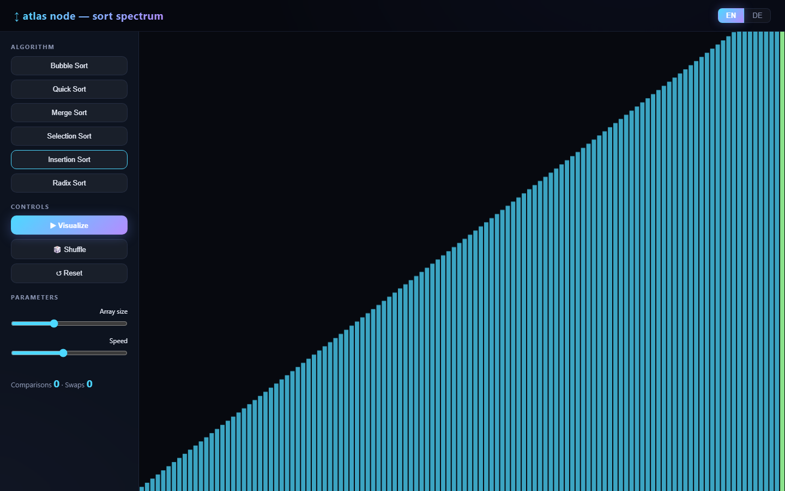
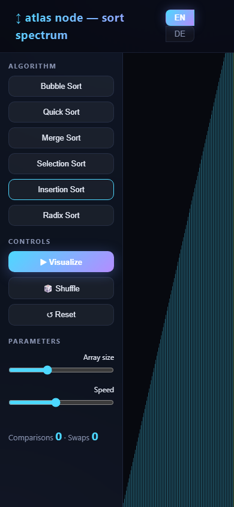

# Atlas Node — Sort Spectrum

A sorting algorithm visualizer featuring Insertion: step-through animation, live comparison/swap counters, 6 algorithms and speed control.

<div align="center">


**[Live Demo](https://ruslanfridenli.github.io/atlas-node/)** · **[Deutsch ↓](#-deutsch)**

</div>

---

## Screenshots






## Features

- 6 sorting algorithms visualized step by step
- Live comparison and swap counters
- Variable array size and animation speed
- Canvas-rendered bar visualization
- Keyboard-free one-click runs
- English/German interface

## Local development

```bash
git clone https://github.com/ruslanfridenli/atlas-node.git
cd atlas-node
# open index.html in a browser, or serve statically:
npx serve .
```

No build step, no dependencies — pure static site.

---

## 🇩🇪 Deutsch

### Atlas Node — Sort Spectrum

Ein Visualisierer für Sortieralgorithmen mit Insertion: Schritt-für-Schritt-Animation, Live-Zähler für Vergleiche/Vertauschungen, 6 Algorithmen und Temposteuerung.

### Funktionen

- 6 Sortieralgorithmen Schritt für Schritt visualisiert
- Live-Zähler für Vergleiche und Vertauschungen
- Variable Arraygröße und Animationstempo
- Canvas-Balkenvisualisierung
- Ein-Klick-Ausführung
- Englische/deutsche Oberfläche

### Lokale Entwicklung

```bash
git clone https://github.com/ruslanfridenli/atlas-node.git
cd atlas-node
npx serve .
```

Reine statische Seite — kein Build-Schritt, keine Abhängigkeiten.

---

## ☕ Support / Unterstützen

Wenn dir diese Website beim Lernen hilft, würde mir eine Spende sehr viel bedeuten und dabei helfen, sie weiterzuentwickeln. Alternativ kannst du das Projekt mit einem Stern im github repo unterstützen. Vielen Dank!

- Solana: `zQpgZ6nGigww7vYpz3Qqxb1BT44kqS567vFaLTeHagS`
- Ethereum: `0x9c4fE1B2e9a1A9c22312c8296BB088Ca0e8F1B4e`
- Bitcoin: `bc1p2jltk9ya9kyzv35d8kxn7mmg9jqkx66cqtgzqwe75zlr4v9jk4hsv468q7`

---

Made with care. Feedback welcome via issues.
